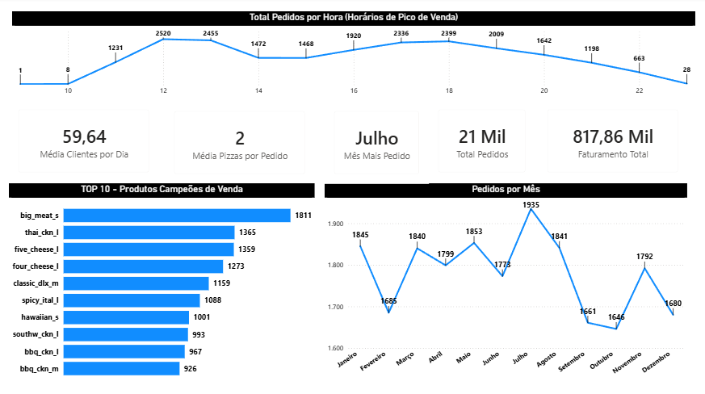

# 🍕 Dashboard de Pedidos - Pizzaria (Power BI)

## 📌 Sobre o Projeto
Este projeto foi desenvolvido para colocar em prática conhecimentos avançados de análise de dados, criação de indicadores (KPIs) e visualização no Power BI. Utilizando um dataset fornecido pela Maven Analytics, o objetivo foi simular o ambiente de negócios de uma pizzaria, respondendo a perguntas estratégicas fundamentais para a operação.

## 🎯 Perguntas de Negócio Respondidas
1. Quantos clientes recebemos por dia? Existem horários de pico?
2. Quantas pizzas costumam compor um pedido? Temos algum produto campeão de vendas?
3. Qual foi o nosso faturamento este ano? Conseguimos identificar alguma sazonalidade nas vendas?

## 📊 Principais Indicadores (KPIs)
- **Clientes por dia:** 59,64
- **Composição do Pedido:** Média de 2 pizzas por pedido
- **Mês de Maior Movimento:** Julho
- **Volume Total:** 21.000 pedidos
- **Faturamento Total:** 817,86 mil

## 📈 Visualizações e Análises
O dashboard conta com análises dinâmicas que incluem:
- Gráfico de Linhas demonstrando o fluxo operacional e **Horários de Pico de Venda**.
- Gráfico de Barras com o **Top 10 Produtos Campeões de Venda**.
- Análise de sazonalidade com a **Quantidade de Pedidos por Mês**.

## 🛠️ Ferramentas e Técnicas Utilizadas
- **Power BI:** Criação de visuais e formatação de dashboards.
- **DAX:** Modelagem de dados, alteração de contexto de filtro (CALCULATE) e funções de iteração e contagem.

Os dados são públicos e disponibilizados através do Maven Analytics(https://mavenanalytics.io/data-playground/pizza-place-sales)

